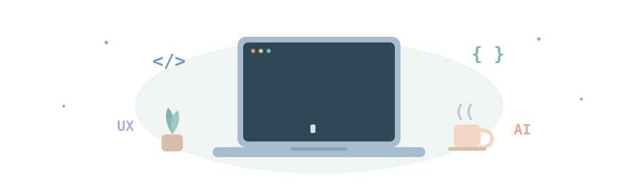

<h1>Ibtida Ara</h1>

CSE Undergraduate · UI/UX &amp; AI + Software Engineering

  

 

 

<a href="#about"><b>About</b></a> &nbsp;·&nbsp;
<a href="#tech-stack"><b>Tech Stack</b></a> &nbsp;·&nbsp;
<a href="#featured-projects"><b>Projects</b></a> &nbsp;·&nbsp;
<a href="#github-stats"><b>Stats</b></a> &nbsp;·&nbsp;
<a href="#lets-connect"><b>Connect</b></a>

  

---

## About

I'm a CSE undergraduate at **United International University, Dhaka**, interested in software systems, UI/UX design, and intelligent automation. I learn best by building, so most of what I know comes from projects I've shipped, broken, and rebuilt.

|  |  |
|---|---|
| 🔬 **Exploring** | Human-computer interaction, sustainable AI, legal AI |
| 🛠️ **Building** | Web apps, mobile design, robots, and research prototypes |
| 🌱 **Mindset** | Steady growth through practical learning |

---

## Tech Stack

<b>See the full list</b>

 

| Category | Technologies |
|---|---|
| **Languages** | C, C++, Java, Python |
| **Web** | HTML, CSS, JavaScript, PHP |
| **Database** | MySQL |
| **Tools** | Git, GitHub, VS Code, Figma |

---

## Featured Projects

> Tap a section to expand it.

<b>🔬 Research & AI</b>

 

**[🌿 Green LLM Token Research](https://github.com/IbtidaAra5/sustainable_green-llm-token-research-edu)** — *Reducing token waste in student LLM use*
Can prompt optimization cut unnecessary token use in university tasks without hurting answer quality? Tested on 100 tasks across 5 categories with 4 models (800 primary runs, temperature 0, seed 42).
Early results: **23.67%** total-token reduction on Gemma 3 4B and **17.16%** on Ministral 3 3B. Cross-model analysis is in progress.
`Python` `Ollama` `Google Colab` `JSONL / CSV`

 

**[💬 Aiva: From Friend to Partner](https://github.com/IbtidaAra5/Aiva-consent-aware_romantic_Ai-companion)** — *Consent-aware relationship transitions in AI companions*
An HCI project (Group Orange) on how an AI companion should handle a shift from friendly to romantic interaction. Built from a 17-person survey, 5 interviews, nine paper sketches, and a high-fidelity Figma prototype, then tested with 8 participants (41 of 48 task attempts completed).
`Figma` `Miro` `Usability Testing` `Affinity Diagramming`

The three major user tasks

 

1. **Choose how romance can begin:** set a starting mode (Friend, Neutral, or Affectionate Partner) and change it later.
2. **Respond to a romantic shift:** recognize a change in tone and accept, decline, postpone, or stay neutral.
3. **Slow, stop, or reverse romance:** ask Aiva to slow down, stop romantic content, or return to friendship.

Testing showed the like/dislike controls were unclear, so five screens were revised to improve conversational input, response tutorials, and settings discovery.

<b>🎨 UI/UX & Design</b>

 

**[💸 ExpenseMate](https://github.com/IbtidaAra5/ExpenseMate)** — *Mobile expense tracker for students and young professionals*
Wireframes and design documentation made with a design-thinking approach. Covers income and expense tracking, smart categorization, analytics, budgets, reminders, light and dark mode, and PDF/CSV export.
`Figma` `Wireframing` `Design Thinking`

 

**[☕ Crimson Cup Bangladesh: Website UI Redesign](https://github.com/IbtidaAra5/Website-UI-Redesign-CRIMSON-CUP)** — *UX redesign driven by heuristic evaluation*
Fixes usability issues found through a Nielsen heuristic evaluation of the live site, moving from mood boarding and a style guide to responsive, high-fidelity desktop and mobile mockups with a clear primary CTA and unified navigation.
`Heuristic Evaluation` `Style Guide` `High-Fidelity Mockups`

<b>💻 Software & Web</b>

 

**[🏥 Curex: Patient Care System](https://github.com/IbtidaAra5/Curex-Mobile-app-Design)** — *Healthcare management*
Streamlines patient records, appointment scheduling, and service management while staying simple for healthcare providers.

 

**[🐾 Pawsitive Tails Veterinary Care](https://github.com/IbtidaAra5/PetCare-Pawsitive-Tails)** — *Frontend demo of a vet care platform* 🚧
Pet profiles, appointments, a vet directory, billing (Card, bKash, Cash), pharmacy orders with prescription checks, and in-app messaging.
`HTML` `CSS` `JavaScript`

 

**[🧺 CleanCare](https://github.com/IbtidaAra5/CleanCare)** — *Laundry service management*
Role-based web app with separate dashboards for Admin, Staff, and Customers to track orders and service updates.

 

**[🎓 UIU-Connect](https://github.com/IbtidaAra5/UIU-Connect-)** — *University social networking platform*
Content sharing, communication, and engagement within an academic community, with a user-friendly interface.

<b>🤖 Embedded & Robotics</b>

 

**[🕷️ AI-Powered Hexapod](https://github.com/IbtidaAra5/AI-Powered-HEXAPOD-for-Autonomous-and-Wireless-Controlled-Navigation)** — *Autonomous and wireless-controlled navigation*
A six-legged robot that detects obstacles, adapts its path in real time, and keeps its movement coordinated across varied environments, with wireless remote control for manual navigation and testing.

 

**[🧳 Smart Cargo Storage System](https://github.com/IbtidaAra5/Cargo-Storage-System)** — *Automated airport cargo safety*
Controlled access and structured monitoring for secure storage management, operational efficiency, and fewer human errors.

---

## GitHub Stats

---

## Let's Connect

Open to collaboration on **UI/UX, AI, and research projects**. Feel free to reach out!

  

Learning continuously · Building consistently · Improving every day ✨

